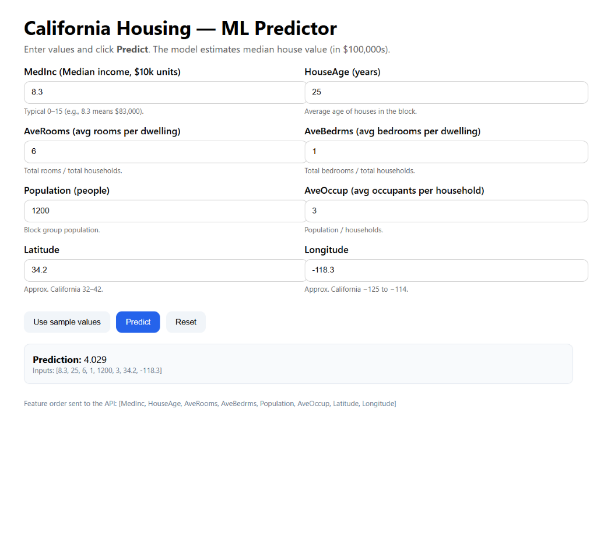

# California Housing — Model as a Service (MaaS)

## Overview

This project deploys a California Housing price-prediction model as a **Model as a Service (MaaS)** web application using **Flask**, **Gunicorn**, and **Docker**.

- **Model:** `RandomForestRegressor(n_estimators=100, random_state=42)` trained on the scikit-learn California Housing dataset with an 80/20 train/test split (`random_state=42`).
- **Target:** Estimated median house value in units of `$100,000` (e.g., `4.03` corresponds to approximately `$403,000`).
- **Tech Stack (`requirements.txt`):**
  - `flask==3.1.3`
  - `gunicorn==26.2.0`
  - `numpy==2.4.6`
  - `scikit-learn==1.9.1`
  - `joblib==1.6.0`
  - `pandas==3.1.1`

---

## Project Structure

```text
ml-deployment-lab/
├── app.py
├── train_model.py
├── requirements.txt
├── Dockerfile
├── templates/
│   └── main.html
├── model/              # generated at build/train time (gitignored)
└── screenshot.png
```

---

## Build and Run with Docker

The `Dockerfile` uses `python:3.11-slim`, installs dependencies from `requirements.txt`, trains and saves `model/model.pkl` during image build, exposes port `5000`, and starts the Flask app via Gunicorn (`gunicorn -w 2 -b 0.0.0.0:5000 app:app`).

1. **Build the Docker image:**

   ```powershell
   docker build -t ds-ml-service .
   ```

2. **Run the container:**

   ```powershell
   docker run -p 5000:5000 ds-ml-service
   ```

   *(Optional: add `--rm` to automatically remove the container when it stops: `docker run --rm -p 5000:5000 ds-ml-service`.)*

3. **Access the service:**
   - **Web UI:** `http://127.0.0.1:5000/`
   - **Health Check:** `http://127.0.0.1:5000/health`

---

## Local Setup (Virtual Environment)

To run and test the service locally without Docker:

1. **Create and activate a virtual environment:**

   On Windows (PowerShell):

   ```powershell
   python -m venv .venv
   .\.venv\Scripts\Activate.ps1
   ```

   On macOS / Linux:

   ```bash
   python -m venv .venv
   source .venv/bin/activate
   ```

2. **Install dependencies:**

   ```powershell
   pip install -r requirements.txt
   ```

3. **Train and save the model (`model/model.pkl`):**

   ```powershell
   python train_model.py
   ```

4. **Start the Flask development server:**

   ```powershell
   python app.py
   ```

   Then open `http://127.0.0.1:5000/` in your browser.

---

## API Endpoints & Example Requests

### Feature Order

Inputs must follow this exact 8-feature order:

`["MedInc", "HouseAge", "AveRooms", "AveBedrms", "Population", "AveOccup", "Latitude", "Longitude"]`

| Index | Feature | Description | Sample Value |
| --- | --- | --- | --- |
| 0 | `MedInc` | Median income in block group (`$10k` units) | `8.3` |
| 1 | `HouseAge` | Median house age in block group (years) | `25.0` |
| 2 | `AveRooms` | Average number of rooms per household | `6.0` |
| 3 | `AveBedrms` | Average number of bedrooms per household | `1.0` |
| 4 | `Population` | Block group population | `1200` |
| 5 | `AveOccup` | Average number of household members | `3.0` |
| 6 | `Latitude` | Block group latitude | `34.2` |
| 7 | `Longitude` | Block group longitude | `-118.3` |

### Endpoints

- **`GET /`**  
  Serves the interactive HTML prediction form (`templates/main.html`).

- **`GET /health`**  
  Returns service status and the expected feature list:

  ```json
  {
    "ok": true,
    "features": [
      "MedInc",
      "HouseAge",
      "AveRooms",
      "AveBedrms",
      "Population",
      "AveOccup",
      "Latitude",
      "Longitude"
    ]
  }
  ```

- **`POST /predict`**  
  Accepts a JSON payload with 8 numeric values under `"features"` and returns the predicted median house value:

  - **Request body:**

    ```json
    {"features": [8.3, 25.0, 6.0, 1.0, 1200, 3.0, 34.2, -118.3]}
    ```

  - **Response (`200 OK`):**

    ```json
    {"prediction": 4.029472199999998}
    ```

    *(Approximately `4.03`, or ~$403,000; trailing decimal digits may vary slightly across environments.)*

  - **Error Response (`400 Bad Request`):**  
    Returned if `"features"` is missing, is not an 8-element list, or contains non-numeric / non-finite values.

### Example Requests

**`curl` (Linux / macOS / Git Bash):**

```bash
curl -s http://127.0.0.1:5000/health
curl -s -X POST http://127.0.0.1:5000/predict \
  -H "Content-Type: application/json" \
  -d '{"features": [8.3, 25.0, 6.0, 1.0, 1200, 3.0, 34.2, -118.3]}'
```

**`curl.exe` (Windows PowerShell):**

```powershell
curl.exe -s http://127.0.0.1:5000/health
curl.exe -s -X POST http://127.0.0.1:5000/predict -H "Content-Type: application/json" -d '{\"features\":[8.3,25.0,6.0,1.0,1200,3.0,34.2,-118.3]}'
```

**PowerShell `Invoke-RestMethod`:**

```powershell
Invoke-RestMethod -Uri http://127.0.0.1:5000/health -Method Get
Invoke-RestMethod -Uri http://127.0.0.1:5000/predict -Method Post -ContentType "application/json" -Body '{"features": [8.3, 25.0, 6.0, 1.0, 1200, 3.0, 34.2, -118.3]}'
```

---

## Web UI Screenshot



---

## Troubleshooting

- **Port `5000` is already in use:**  
  Stop the conflicting process using port `5000`, or map a different host port when starting the Docker container:

  ```powershell
  docker run -p 8080:5000 ds-ml-service
  ```

  Then access the app at `http://127.0.0.1:8080/`.

- **Docker daemon is not running:**  
  Start **Docker Desktop** and wait until the engine is ready before running `docker build` or `docker run`. If Docker reports a `read-only file system` error, verify your system drive (e.g., `C:`) has at least 5 GB of free space and restart Docker Desktop.

- **`400 Bad Request` from `POST /predict`:**  
  Ensure the request sets `Content-Type: application/json` and passes `"features"` as a JSON array of **exactly 8 numeric values** in the order `["MedInc", "HouseAge", "AveRooms", "AveBedrms", "Population", "AveOccup", "Latitude", "Longitude"]`.

- **`FileNotFoundError` for `model/model.pkl` when running locally:**  
  `model/` is generated at training/build time and excluded from Git. Run `python train_model.py` first to generate `model/model.pkl` before running `python app.py`.

- **`TemplateNotFound: main.html` or `gunicorn: not found`:**  
  Verify `templates/main.html` is present inside `templates/`, and verify `gunicorn` is listed in `requirements.txt` before rebuilding the Docker image.
